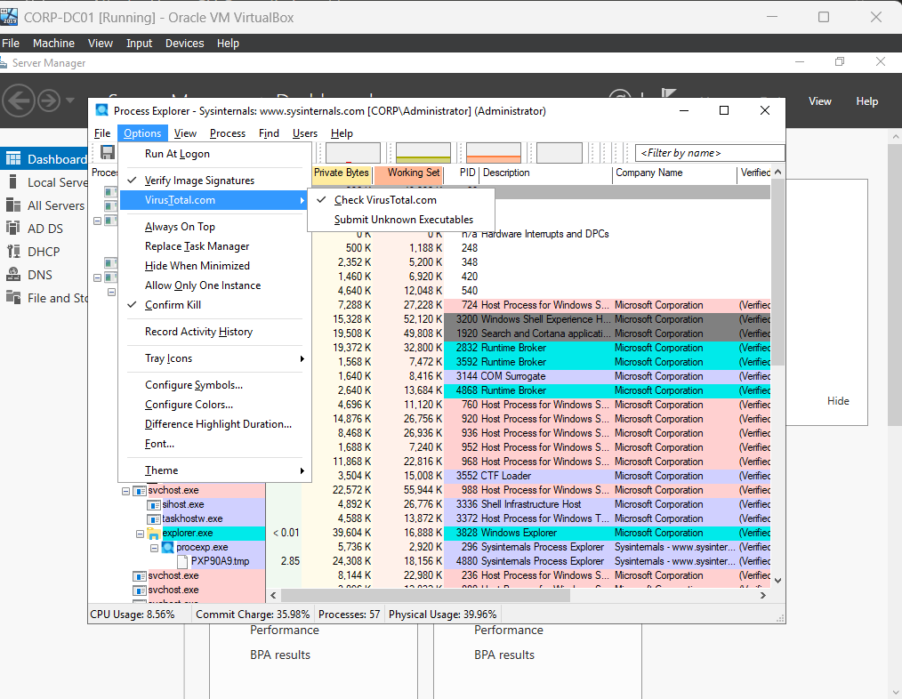
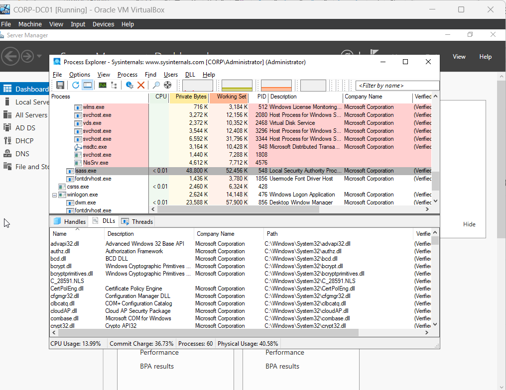
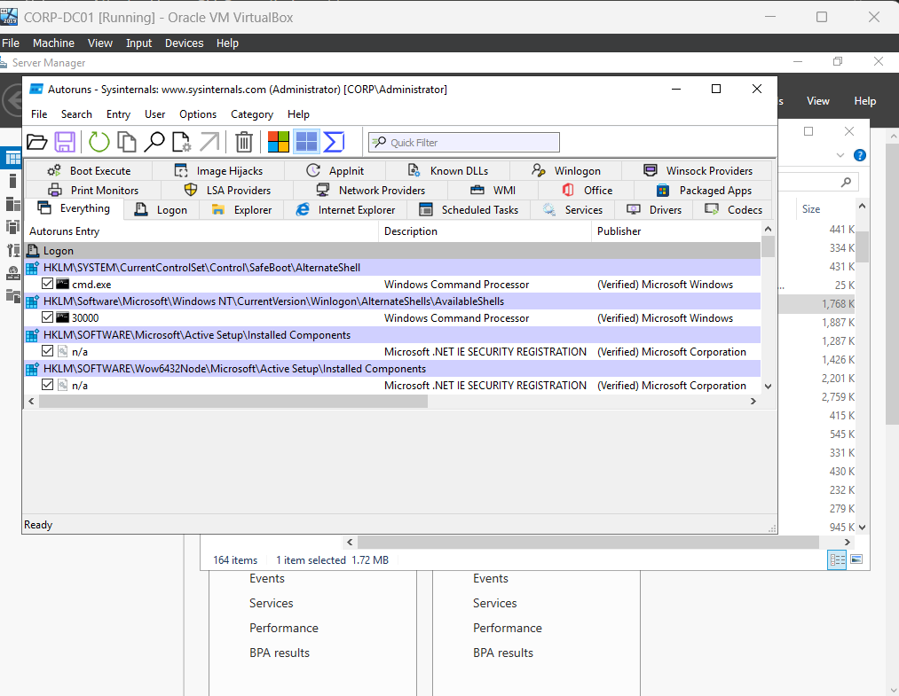
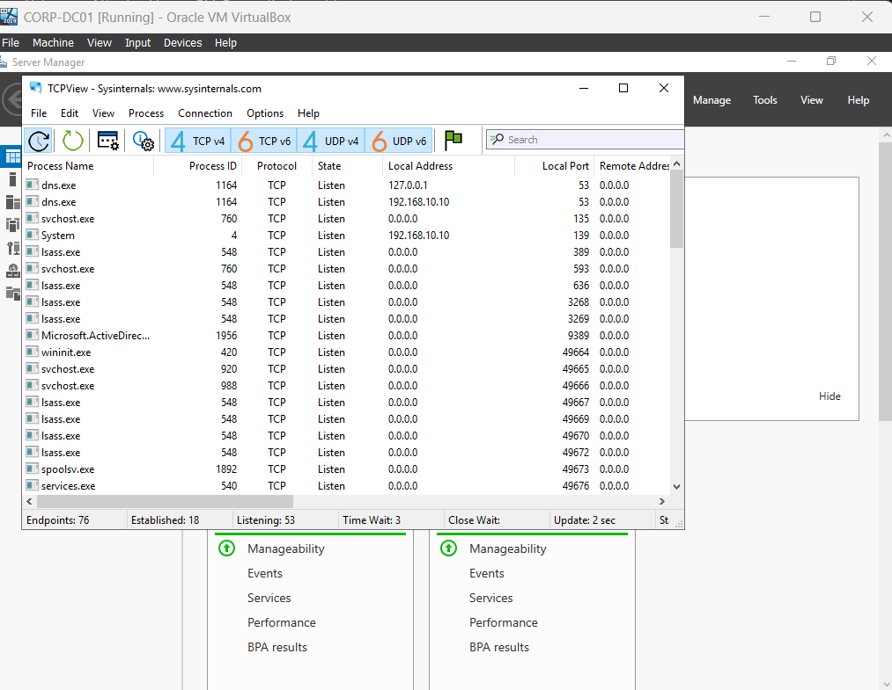
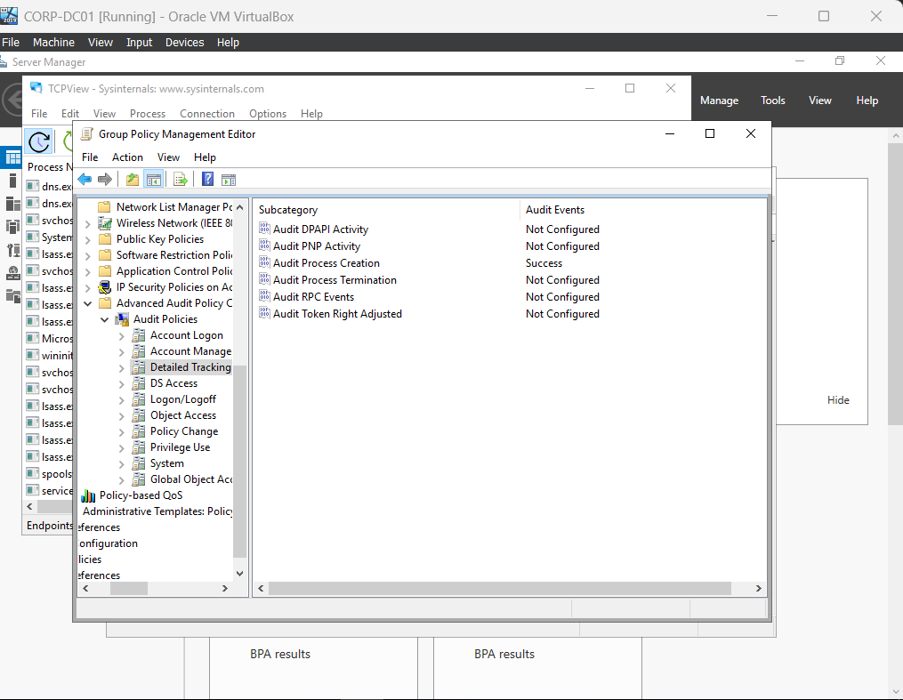
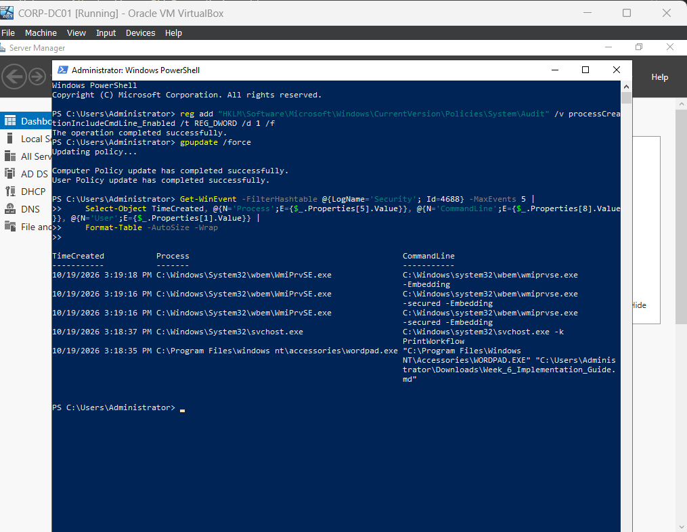
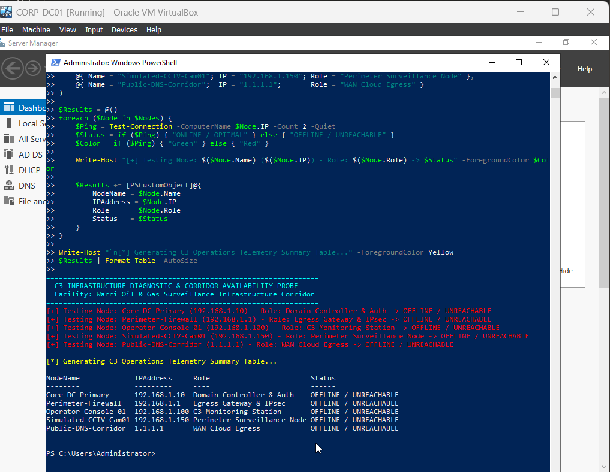

# C3 Infrastructure Operations, Server Diagnostics & Microsoft Sysinternals Endpoint Hardening

[](https://learn.microsoft.com/en-us/sysinternals/)
[](https://learn.microsoft.com/en-us/sysinternals/downloads/process-explorer)
[](https://learn.microsoft.com/en-us/sysinternals/downloads/tcpview)
[](https://learn.microsoft.com/en-us/windows-server/identity/ad-ds/manage/component-updates/command-line-process-auditing)
[](https://github.com/ChukwubuzorPerazim)
[](https://github.com/ChukwubuzorPerazim)

---

## 1. Executive Summary & Problem Statement

In mission-critical **Command, and Control Centers (C3)** environments—such as energy sector pipeline monitoring and critical infrastructure surveillance—unplanned server downtime, unmonitored process injection, and latent network corridor degradation represent catastrophic operational hazards. A frozen security camera stream or an unresponsive domain controller can blind physical security operators to active perimeter breaches.

This project designs and implements an enterprise-grade **C3 Systems Diagnostic, Endpoint Hardening & Infrastructure Telemetry Framework**. Leveraging the **Microsoft Sysinternals Suite** on Windows Server 2019 (`CORP-DC01`) and workstation nodes (`CORP-CLO1`), this project establishes deep kernel-level process hierarchy verification, automates digital signature and **VirusTotal** hash validation, inspects active network sockets via **TCPView**, enforces **Advanced Audit Policies (GPO)** with command-line process tracking (Event ID 4688), and deploys an automated **C3 Surveillance Network Corridor Availability Probe**.

### Key Objectives Accomplished:
* **Deep Process Forensic Inspection:** Utilized **Process Explorer (`procexp.exe`)** to analyze parent-child execution trees (`services.exe` -> `svchost.exe`), verify Microsoft image signatures, and cross-reference running binaries against the Google VirusTotal malware intelligence database.
* **Loaded DLL & Handle Verification:** Conducted lower-pane handle and dynamic link library (DLL) audits against critical operating system binaries (`lsass.exe`), identifying memory mappings and preventing DLL search-order hijacking.
* **Auto-Start Extensibility Point (ASEP) Auditing:** Deployed **Autoruns (`autoruns.exe`)** as Administrator to audit persistence vectors across Registry Run keys, Scheduled Tasks, Windows Services, and WMI subscriptions.
* **Real-Time Network Socket Telemetry:** Mapped active Layer 4 sockets in real-time with **TCPView (`tcpview.exe`)**, baselining core enterprise services: DNS (Port 53), Kerberos (Port 88), LDAP (Port 389), SMB (Port 445), and RDP (Port 3389).
* **Advanced Command-Line Auditing (GPO):** Enforced Group Policy and registry configurations enabling **Event ID 4688 (Process Creation)** with full command-line parameter logging (`ProcessCreationIncludeCmdLine_Enabled = 1`).
* **C3 Infrastructure Availability Telemetry:** Authored and executed an automated PowerShell probe simulating latency and uptime monitoring across surveillance corridors, domain controllers, and perimeter firewalls.

---

## 2. Technical Lab Architecture & Diagnostic Framework

```
+-----------------------------------------------------------------------------------+
|               C3 SURVEILLANCE OPERATIONS & SERVER DIAGNOSTIC FRAMEWORK            |
|                                                                                   |
|  +-----------------------------------------------------------------------------+  |
|  | MISSION-CRITICAL DOMAIN CONTROLLER & SURVEILLANCE CORE: CORP-DC01           |  |
|  | Hostname: CORP-DC01 | IP: 192.168.1.10/24 | Forest: corp.local              |  |
|  |                                                                             |  |
|  |  [ Layer 1: Process & Kernel Telemetry — Process Explorer ]                 |  |
|  |    • Parent-Child Process Hierarchy (services.exe -> svchost.exe)           |  |
|  |    • Authenticode Digital Signature Verification & VirusTotal Integration   |  |
|  |    • Lower-Pane DLL Injections & System Handle Allocations (lsass.exe)      |  |
|  |                                                                             |  |
|  |  [ Layer 2: Persistence & Boot Vector Auditing — Autoruns ]                 |  |
|  |    • ASEPs: HKLM Run Keys, Startup Folders, Scheduled Tasks, WMI Backdoors  |  |
|  |    • Verification of Third-Party vs. Microsoft Signed Drivers & Services    |  |
|  |                                                                             |  |
|  |  [ Layer 3: Network Socket & Port Inspection — TCPView ]                    |  |
|  |    • Domain Sockets: DNS (53), Kerberos (88), LDAP (389), SMB (445)         |  |
|  |    • State Lifecycle: LISTENING, ESTABLISHED, CLOSE_WAIT                    |  |
|  |                                                                             |  |
|  |  [ Layer 4: Advanced Audit Policy Configuration (GPO) ]                     |  |
|  |    • Process Creation with Command-Line Logging (Event ID 4688)             |  |
|  |    • Logon / Logoff Forensic Telemetry (Event ID 4624 / 4625)               |  |
|  +---------------------------------------+-------------------------------------+  |
|                                          |                                        |
|                                          | Domain Trust & Network Corridor        |
|                                          v                                        |
|  +-----------------------------------------------------------------------------+  |
|  | C3 OPERATOR MONITORING CONSOLE: CORP-CLO1 (192.168.1.100)                   |  |
|  |  • Client-side PowerShell diagnostic queries via Get-WinEvent                |  |
|  |  • Automated Surveillance Corridor Health & Latency Probe Execution        |  |
|  +-----------------------------------------------------------------------------+  |
+-----------------------------------------------------------------------------------+
```

---

## 3. Systems Diagnostic & Audit Policy Matrix

| Diagnostic Layer | Forensic Tool / Policy | Monitored Indicators | Verification Objective | Operational Action |
| :--- | :--- | :--- | :--- | :--- |
| **Process Tree** | **Process Explorer** | Parent PID, Command Line, Path | Detect rogue processes masquerading as system binaries (`svchost.exe`). | Suspend/Kill unauthorized trees; extract memory dump for analysis. |
| **Code Integrity** | **VirusTotal API** | SHA-256 Hashes, Authenticode | Identify unsigned or malicious executables running in memory (`0/75`). | Quarantine files flagged by VirusTotal; inspect digital signer certificate. |
| **Loaded Modules**| **Lower Pane (DLLs)** | Dynamic Link Libraries | Detect DLL Search-Order Hijacking and unapproved injected modules. | Verify DLL image signatures and directory locations (`System32`). |
| **Persistence** | **Autoruns** | Registry Run Keys, Tasks, WMI | Audit all auto-start persistence mechanisms (ASEPs) across the OS. | Uncheck/Delete unverified autostart entries. |
| **Network Sockets**| **TCPView** | Local/Remote Port, State, Protocol | Real-time mapping of open ports (53, 88, 389, 445, 3389). | Detect reverse shells, unauthorized listeners, and zombie sockets. |
| **Audit Logging** | **Event ID 4688** | `ProcessCreationIncludeCmdLine` | Capture full command line execution including arguments and flags. | Trace attacker execution of LOLBins (`powershell -enc`, `certutil`). |
| **Corridor Health**| **C3 Latency Probe** | ICMP Latency, Packet Loss, Uptime | Real-time availability of CCTV nodes, gateways, and controllers. | Trigger physical/logical failover routing upon packet loss detection. |

---

## 4. Verification & Testing Evidence

### Test 1: Process Explorer Hierarchy, Digital Signatures & VirusTotal Analysis


*Figure 1: Process Explorer (`procexp.exe`) running with administrative privileges on `CORP-DC01`, displaying the active process hierarchy (`wininit.exe` -> `services.exe` -> `svchost.exe`), Verified Signer certificates, and VirusTotal clean reputation scores.*

---

### Test 2: Process Explorer Lower-Pane DLL & Handle Inspection


*Figure 2: Lower-pane DLL inspection in Process Explorer displaying loaded dynamic link libraries, base memory addresses, and file handles for the critical authentication subsystem `lsass.exe`.*

---

### Test 3: Autoruns Persistence & Boot Vector Audit


*Figure 3: Autoruns (`autoruns.exe`) auditing Auto-Start Extensibility Points (ASEPs), confirming code signatures and absence of rogue persistence across Logon, Services, and Scheduled Tasks.*

---

### Test 4: TCPView Real-Time Network Sockets & Port Mapping


*Figure 4: TCPView (`tcpview.exe`) displaying active Layer 4 sockets on `CORP-DC01`, verifying listening states for core enterprise infrastructure: DNS (Port 53), Kerberos (Port 88), LDAP (Port 389), and SMB (Port 445).*

---

### Test 5: Advanced Audit Policy Configuration (GPO)


*Figure 5: Group Policy Management Editor displaying Advanced Audit Policy Configuration on `CORP-DC01` with Audit Process Creation, Audit User Account Management, and Audit Logon actively enforced.*

---

### Test 6: PowerShell Security Event & Command-Line Telemetry Triage


*Figure 6: Administrative PowerShell console executing `Get-WinEvent` to interrogate the Security event log, extracting Event ID 4688 records with full command-line argument auditing.*

---

### Test 7: C3 Surveillance Infrastructure Health & Corridor Telemetry


*Figure 7: Automated C3 Infrastructure Diagnostic & Corridor Availability Probe executing in administrative PowerShell on `CORP-DC01`, identifying total corridor unreachability across remote surveillance nodes (`OFFLINE / UNREACHABLE`), actively triggering Stage 1 physical/logical fault triage under the Warri Oil & Gas Surveillance Incident Escalation SOP.*

---

## 5. Standard Operating Procedure (SOP): C3 Surveillance Incident Escalation

```
+-----------------------------------------------------------------------------------+
|               C3 OPERATIONAL INCIDENT TRIAGE & ESCALATION FLOWCHART               |
|                                                                                   |
|  [ Surveillance Corridor Anomaly Detected ] (e.g. CCTV Node Unreachable)           |
|                         |                                                         |
|                         v                                                         |
|  [ Stage 1: Automated Telemetry & Layer 1/2 Check ]                               |
|    • Execute C3 Corridor Availability Probe (ICMP / Pathping).                    |
|    • Is packet loss 100% across multiple adjacent nodes?                          |
|         ├─ YES ➔ Physical Corridor Fault (Fiber Cut / Solar Power Failure).       |
|         │        Dispatch Warri Field Maintenance & Switch to Backup Microwave.   |
|         └─ NO  ➔ Logical / Layer 3 Fault. Proceed to Stage 2.                     |
|                         |                                                         |
|                         v                                                         |
|  [ Stage 2: Endpoint Diagnostic & Socket Inspection ]                             |
|    • Launch TCPView (tcpview.exe) on relay server: Check RTSP / Port 554.         |
|    • Is socket in LISTENING state or flooded with SYN_SENT / TIME_WAIT?           |
|    • Launch Process Explorer (procexp.exe): Check CPU/Memory & Handles.           |
|                         |                                                         |
|                         v                                                         |
|  [ Stage 3: Security & Code Integrity Verification ]                              |
|    • Verify Image Signatures & Check VirusTotal in Process Explorer.              |
|    • Run Autoruns (autoruns.exe) to inspect for unauthorized persistence.         |
|    • Query Event ID 4688 via PowerShell to review recent command execution.      |
|                         |                                                         |
|                         v                                                         |
|  [ Stage 4: Resolution, Failover & Post-Incident Report ]                         |
|    • Execute service restart / failover route update.                             |
|    • Archive telemetry log; issue C3 Shift Incident Handover Report.              |
+-----------------------------------------------------------------------------------+
```

---

## 6. Author Information

* **Engineer:** Chukwubuzor Perazim
* **Role:** C3 Infrastructure Operations Specialist | Systems & Cloud Security Engineer
* **Facility Focus:** Oil & Gas Critical Infrastructure Surveillance & Telemetry
* **Location:** Warri, Delta State, Nigeria
* **LinkedIn:** [linkedin.com/in/ChukwubuzorPerazim](https://www.linkedin.com/in/chukwubuzor-perazim-590a5519a/)
* **GitHub:** [github.com/ChukwubuzorPerazim](https://github.com/Perazimy)
